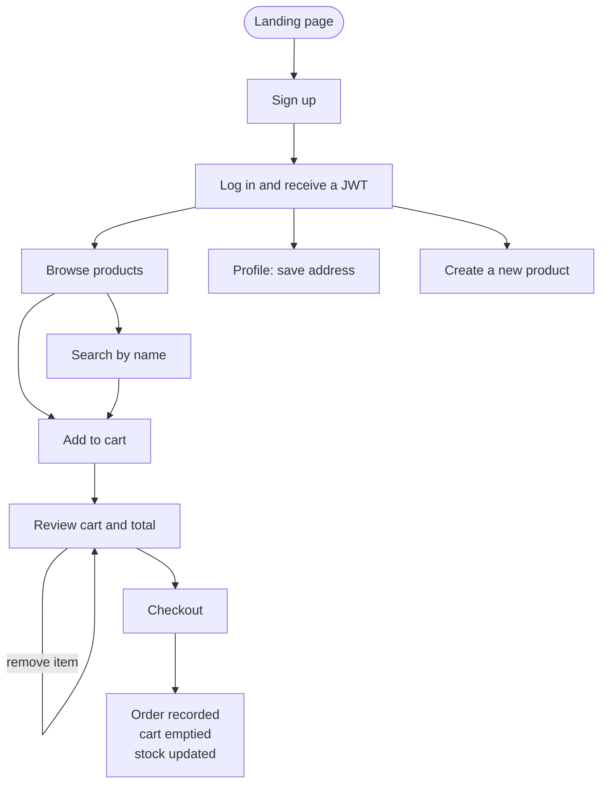
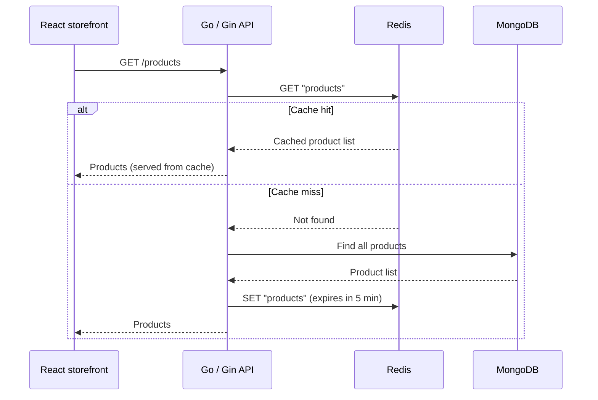
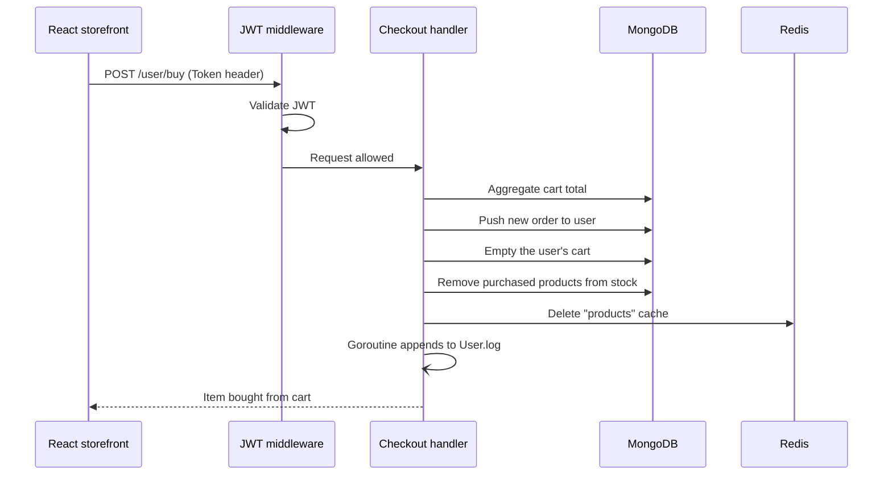
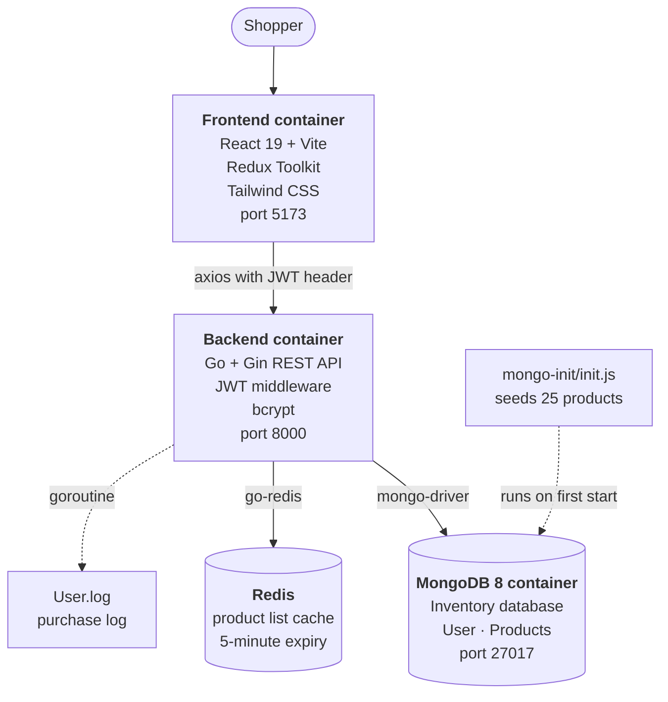
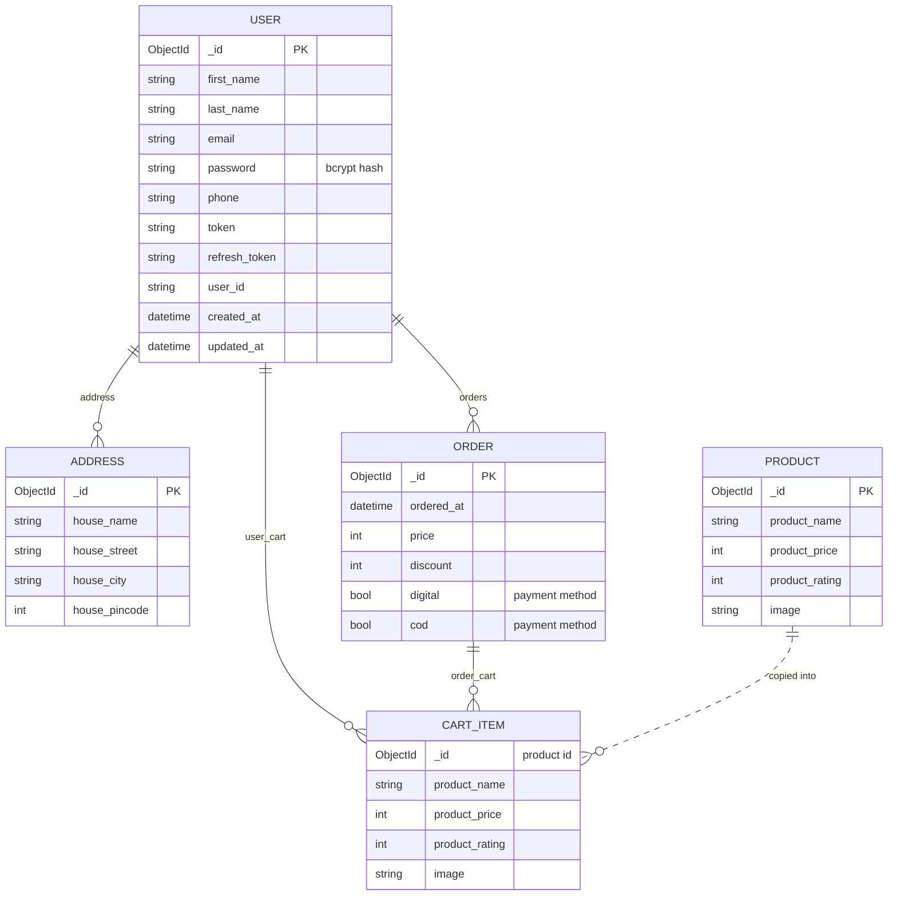

<div align="center">

<h1>StockForge</h1>

<p><b>A full-stack e-commerce and inventory platform with a Go backend</b></p>

<p><i>Browse products, manage your cart and check out. Powered by Gin, MongoDB, Redis caching and React, all running with one Docker command.</i></p>


**A REST API in Go with JWT authentication and a Redis-cached product catalogue,<br>a React and Redux storefront, and a MongoDB database seeded with 25 products.**

[Features](#features) · [How It Works](#how-it-works) · [Architecture](#architecture) · [Getting Started](#getting-started) · [API](#api-reference) · [Roadmap](#roadmap)

</div>

---

## Overview

**StockForge** is a full-stack shopping and inventory application split into three services:

- **Backend.** A REST API written in **Go** with the **Gin** framework. It handles sign-up and login with **bcrypt** and **JWT**, the product catalogue, search, carts, addresses and checkout.
- **Frontend.** A **React 19** storefront built with **Vite** and **Tailwind CSS**. It uses **Redux Toolkit** for cart and auth state and **React Router** for navigation.
- **Data.** **MongoDB** stores users, carts, orders and products, and is seeded with 25 real products on first start. **Redis** caches the product list so repeat visits don't hit the database.

Every service runs in its own container, and **Docker Compose** starts the whole stack with a single command.

## Features

| Feature | How it works |
|---|---|
| **JWT authentication** | Passwords are hashed with bcrypt. Login returns a signed JWT (HS256, 24-hour expiry), and a refresh token is also generated. The frontend attaches the JWT to every request in a `Token` header. |
| **Protected routes** | Gin middleware validates the JWT before any cart, checkout or address request reaches its handler. |
| **Redis-cached catalogue** | `GET /products` serves the product list from Redis when it's cached. On a cache miss it reads MongoDB and caches the result for 5 minutes. |
| **Automatic cache invalidation** | Adding a product or completing a purchase deletes the cache key, so shoppers never see stale stock. |
| **Product search** | Case-insensitive search by name using a MongoDB regular-expression query. |
| **Shopping cart** | Add and remove products. The cart lives inside the user's document, and the total is calculated on the server. |
| **Checkout and inventory** | Checkout totals the cart with a MongoDB aggregation pipeline, records an order, empties the cart and removes the purchased items from stock. |
| **Background purchase log** | Each purchase is written to `User.log` in a separate goroutine, so the response is never slowed down. |
| **Address book** | Users can save delivery addresses to their profile. |
| **Add products** | A form in the storefront creates new catalogue items. |
| **Global state with Redux Toolkit** | Cart items and totals are loaded with an async thunk. Auth state (token and user id) is persisted to `localStorage`. |
| **One-command setup** | Docker Compose builds the Go and React images, starts MongoDB 8 with a persistent volume, and seeds the products automatically. |

## How It Works

### User journey



### Loading products with the Redis cache



### Checkout



## Architecture



**Design highlights**

- **Cache-aside pattern.** The API checks Redis first, falls back to MongoDB, and writes the result back to Redis with a TTL. Any write that changes the catalogue invalidates the cache.
- **Embedded documents.** Each user document holds its cart, addresses and orders, so a profile or cart is fetched in a single read.
- **Aggregation pipeline.** Cart totals at checkout are computed inside MongoDB with `$unwind` and `$group`.
- **Concurrency.** Purchase logging runs in a goroutine so file I/O never blocks the HTTP response.
- **Containerised.** Separate Dockerfiles for the Go API and the React app, joined by Docker Compose with a named volume for MongoDB data.

## Data Model



## Tech Stack

| Layer | Technology |
|---|---|
| Backend | Go, Gin, gin-contrib/cors |
| Authentication | JWT (`dgrijalva/jwt-go`), bcrypt (`golang.org/x/crypto`) |
| Validation | go-playground/validator |
| Database | MongoDB 8 with the official Go driver |
| Cache | Redis via `go-redis` (works with Upstash or a local Redis) |
| Frontend | React 19, Vite, React Router 7 |
| State management | Redux Toolkit, React Redux |
| Styling and UI | Tailwind CSS 4, React Icons, React Hot Toast |
| HTTP client | Axios with a request interceptor for the JWT |
| DevOps | Docker, Docker Compose |
| Linting | oxlint |

## Project Structure

```
StockForge/
├── backend/
│   ├── main.go               # Gin server, CORS, Redis connection
│   ├── routes/routes.go      # Public and JWT-protected routes
│   ├── controllers/
│   │   ├── controllers.go    # Sign-up, login, add product, cart total
│   │   ├── cart.go           # Cart, checkout, product list (cached), search
│   │   └── address.go        # Save delivery addresses
│   ├── database/
│   │   ├── setup.go          # MongoDB connection
│   │   ├── redis.go          # Redis connection
│   │   └── cart.go           # Cart and checkout database logic, order history
│   ├── middleware/           # JWT authorization middleware
│   ├── token/                # JWT generation and validation
│   ├── models/               # User, Product, Address, Order structs
│   └── Dockerfile
├── frontend/
│   ├── src/
│   │   ├── pages/            # Landing, Home, Login, Signup, Cart, Profile, CreateProduct
│   │   ├── components/       # Navbar, ProductCard, SearchBar
│   │   ├── api/axios.js      # Axios instance that attaches the JWT
│   │   └── context/          # Auth context
│   ├── redux/                # Store, cart slice, auth slice
│   └── Dockerfile
├── mongo-init/init.js        # Seeds 25 products on first start
└── docker-compose.yml        # Backend, frontend and MongoDB services
```

## Getting Started

### Prerequisites

- **Docker Desktop** (includes Docker Compose)
- A **Redis** instance. A free [Upstash](https://upstash.com) database works well, or run Redis locally.

### 1. Clone the repository

```bash
git clone https://github.com/Ashwin-Laad/StockForge.git
cd StockForge
```

### 2. Configure Redis

The backend connects to Redis in `backend/database/redis.go`. Point it at your own Redis instance:

```go
opt, err := redis.ParseURL(os.Getenv("REDIS_URL"))
```

and provide the URL to the backend container in `docker-compose.yml`:

```yaml
backend:
  build: ./backend
  environment:
    - REDIS_URL=rediss://default:<password>@<your-host>.upstash.io:6379
```

> Keep real credentials out of Git. Use environment variables or an untracked `.env` file.

### 3. Start everything

```bash
docker compose up --build
```

| Service | URL |
|---|---|
| Frontend | [http://localhost:5173](http://localhost:5173) |
| Backend API | [http://localhost:8000](http://localhost:8000) |
| MongoDB | `mongodb://localhost:27017` |

On the first start, MongoDB runs `mongo-init/init.js` and loads 25 products into the `Inventory` database.

### 4. Try it out

1. Open the storefront, **sign up** and **log in**.
2. Browse or **search** the catalogue and **add items** to your cart.
3. Open the **cart** to see the total, remove an item, then **check out**.
4. Visit your **profile** to save a delivery address.

### Stop and reset

```bash
docker compose down        # stop the containers
docker compose down -v     # stop and delete the MongoDB data volume (re-seeds next time)
```

## API Reference

Protected routes need a valid JWT in the `Token` request header.

### Authentication

| Method | Endpoint | Description |
|---|---|---|
| `POST` | `/user/signup` | Create an account (password is hashed with bcrypt) |
| `POST` | `/user/login` | Log in and receive a JWT and the user id |

### Products

| Method | Endpoint | Description |
|---|---|---|
| `GET` | `/products` | List all products (served from the Redis cache when available) |
| `GET` | `/products/search?name=<text>` | Case-insensitive search by product name |
| `POST` | `/products` | Add a product and clear the product cache |

### Cart and orders

| Method | Endpoint | Auth | Description |
|---|---|---|---|
| `POST` | `/user/add-product?id=<userId>&iD=<productId>` | JWT | Add a product to the cart |
| `DELETE` | `/user/remove-product?id=<productId>&user_id=<userId>` | JWT | Remove a product from the cart |
| `GET` | `/user/cart/total?id=<userId>` | JWT | Cart items and total |
| `GET` | `/get-cart?id=<userId>` | | Cart items and total (used by the storefront) |
| `POST` | `/user/buy?id=<userId>` | JWT | Check out the cart |
| `GET` | `/prev-order?user_id=<userId>` | | Previous orders |

### Profile

| Method | Endpoint | Auth | Description |
|---|---|---|---|
| `POST` | `/user/address?id=<userId>` | JWT | Save a delivery address |


## Contributing

Contributions, issues and suggestions are welcome.

1. Fork the repo
2. Create a branch: `git checkout -b feature/your-feature`
3. Commit your changes: `git commit -m "Add your feature"`
4. Push and open a Pull Request

## Author

**Ashwin Laad**: [@Ashwin-Laad](https://github.com/Ashwin-Laad)


---

<sub>Built to explore backend development in Go, caching strategies with Redis and containerised full-stack apps.</sub>
